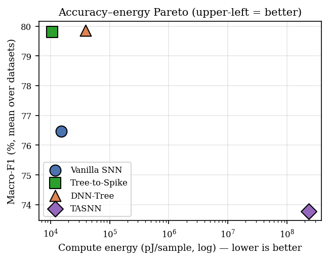

# HiSNN — Hybrid Spiking Neural Networks for Energy-Efficient Intrusion Detection

A reproducible study asking one question: **can a compact spiking model match a dense DNN
(and a transformer SOTA) at network-intrusion detection, while using far less energy?**

We answer it with a **4-way comparison** — **Vanilla SNN, Tree-to-Spike, DNN-Tree, and
TASNN** — evaluated on **11 IDS datasets × 5 seeds** under one fair protocol (identical
features, no resampling, same splits). The headline model is **Tree-to-Spike**: a
GBDT-guided spike encoder feeding a distilled, int8, early-exit spiking student.

All comparison figures and tables are in [results/Journal_results/](results/Journal_results),
regenerated by [scripts/benchmark_4way.py](scripts/benchmark_4way.py).



---

## TL;DR — key results

| Model | Params* | Energy @32b (pJ/sample) | Mean Macro-F1 |
|---|--:|--:|--:|
| **Tree-to-Spike** (headline) | **8,661** | **10,547** | 79.8 |
| DNN-Tree (matched dense twin) | 8,661 | 39,225 | **79.9** |
| Vanilla SNN | 14,028 | 15,321 | 76.5 |
| TASNN (transformer-spiking SOTA) | 547,727 | 231,814,392 | 73.8 |

\* per-dataset mean; Tree-to-Spike and DNN-Tree are **parameter-identical**.

- **Comparable quality, far lower energy.** Tree-to-Spike is **statistically tied** with the
  parameter-matched DNN-Tree on detection quality (Friedman–Nemenyi critical-difference test)
  while using **3.7× less compute energy at 32-bit / 5.6× at int8** (Horowitz 45 nm; SOPs vs MACs,
  input layer counted for both).
- **Beats the SOTA at a fraction of the size.** Tree-to-Spike Pareto-**dominates** the 548K-param
  TASNN transformer — higher Macro-F1, ~60× fewer parameters, and ~33,000× lower compute energy —
  on identical features with TASNN's privileged preprocessing (PAAN / Port-Role / SMOTE-Tomek)
  removed for fairness.
- **The encoder is the efficiency mechanism.** Ablating it (`tree | uniform | all`) shows a dense
  all-channel encoder costs **~2× the spikes** for ≤1.7 Macro-F1 points — the importance-guided
  channel budget is what saves energy, not the spiking paradigm alone.

---

## The four models

| Model | Code | What it is |
|---|---|---|
| **Vanilla SNN** | [src/models/snn.py](src/models/snn.py) | `LeakyParallel` neuron + `latency` (TTFS) encoding — the winner of the Phase-1 neuron×encoding ablation, carried forward as the SNN backbone. |
| **Tree-to-Spike** | [src/models/tree_to_spike.py](src/models/tree_to_spike.py) | **Headline model.** A cost-sensitive XGBoost teacher guides (a) a fixed **spike encoder** whose latency bins come from tree thresholds and whose per-feature channel budget comes from feature importance (weak features pruned), and (b) a compact LIF-MLP **student** trained by distillation. Deploys as **encoder + SNN student only** — int8-quantized, with confidence-triggered **early exit**. |
| **DNN-Tree** | [src/models/dnn_student.py](src/models/dnn_student.py) | The **iso-architecture dense twin** of Tree-to-Spike: identical Linear topology and **identical parameter count** (LIF neurons add no weights), ReLU instead of spiking, one-shot (T=1). Isolates the spiking-vs-dense effect. Also int8. |
| **TASNN** | [src/models/tasnn.py](src/models/tasnn.py) | Faithful reimplementation of the transformer–spiking SOTA (*Sci. Rep.* 2026): FlowToken transformer → spike-temporal conv → LIF core → cross-modal-gated dual heads. Run on **our shared features** (its PAAN / Port-Role / CPSMOTE-Tomek preprocessing deliberately excluded — see [experiments/TASNN/README.md](experiments/TASNN/README.md)). |

---

## Datasets (11)

Six classic IDS benchmarks + five modern IoT/IIoT/IoMT benchmarks. Full taxonomy / split /
preprocessing / citations are in [SOTA_DATASETS.md](SOTA_DATASETS.md). Raw data lives under
`dataset/` (gitignored).

**Classic (6).** 5-class `{normal,dos,probe,r2l,u2r}` (KDDCup99, NSL-KDD, CIC-IDS2017,
CSE-CIC-IDS2018) or binary (CTU-13, ISCXIDS2012).

| Dataset | Path | Source |
|---|---|---|
| KDD Cup 1999 | `dataset/kddcup99/` | [kdd.org](https://www.kdd.org/kdd-cup/view/kdd-cup-1999/Data) |
| NSL-KDD | `dataset/nslkdd/` | [UNB CIC](http://www.unb.ca/cic/datasets/nsl.html) |
| CTU-13 | `dataset/ctu13/` | [Stratosphere IPS](https://www.stratosphereips.org/datasets-ctu13) |
| ISCXIDS2012 | `dataset/iscxids2012/` | [UNB CIC](https://www.unb.ca/cic/datasets/ids.html) |
| CIC-IDS2017 | `dataset/cicids2017/` | [UNB CIC](https://www.unb.ca/cic/datasets/ids-2017.html) |
| CSE-CIC-IDS2018 | `dataset/cse-cic-ids2018/` | [UNB CIC](https://www.unb.ca/cic/datasets/ids-2018.html) |

**Modern IoT / IIoT / IoMT (5).** Class taxonomy verified against each source paper.

| Dataset | Path | Classes (used) | Source |
|---|---|--:|---|
| CICIoT2023 | `dataset/cic-iot2023/` | 8 (category) | Neto et al., *Sensors* 2023 |
| CICIoMT2024 | `dataset/cic-iomt-2024/` | 6 (category) | Dadkhah et al., *Internet of Things* 2024 |
| Edge-IIoTset | `dataset/edge-iiotset/` | 15 (`Attack_type`) | Ferrag et al., *IEEE Access* 2022 |
| UNSW-NB15 | `dataset/unsw-nb15/` | 10 (`attack_cat`) | Moustafa & Slay, *MilCIS* 2015 |
| TON-IoT | `dataset/ton-iot/` | 10 (`type`) | Moustafa, *Sustainable Cities & Society* 2021 |

> **Honest-protocol note.** We use official train/test splits where provided (NSL-KDD's
> KDDTest+, UNSW-NB15's partition). Their distribution shift caps accuracy at ~76% — the
> Kaggle-style ~99% figures come from IID re-splits and/or SMOTE, which we avoid. See
> [SOTA_DATASETS.md](SOTA_DATASETS.md) §8.

---

## Metrics

All produced by [src/metrics.py](src/metrics.py) so every row is apples-to-apples.

- **Detection quality** — accuracy, balanced-accuracy, macro/weighted-F1, **MCC**, Cohen's κ,
  ROC-AUC (+ per-class).
- **IDS-canonical** (binary normal-vs-attack) — **detection rate (DR)** and **false-alarm rate
  (FAR)**, the field's primary report-card metrics.
- **Efficiency / energy** — SOPs/sample (spiking) vs MACs/sample (dense); **operation energy at
  matched precision** (32-bit & int8, Horowitz 45 nm, input layer counted for both paradigms);
  spike sparsity; early-exit mean-exit-step; parameters; batch-1 latency.
- **Representation** — silhouette of the penultimate layer (cluster separability).

---

## Results in depth (artifacts in `results/Journal_results/`)

| Theme | Figures / tables |
|---|---|
| **Detection quality** | `table_{accuracy,f1_macro,mcc,DR,FAR}.{md,tex}`, `bar_*`, `heatmap_*`, `radar_4way` |
| **Statistical significance** | `cd_diagram_{f1_macro,mcc}` (Friedman–Nemenyi), `meanrank_*` — Tree-to-Spike is tied with DNN-Tree and both beat TASNN |
| **Energy / efficiency** | `table_efficiency` (32b + int8), `energy_iso_trio`, `energy_4way`, `energy_precision`, `pareto_f1_vs_{params,energy}` |
| **Encoder ablation** | `encoder_ablation_{sops,frontier}`, `table_encoder_ablation` — the all-channel encoder costs ~2× for ≤1.7 F1 |
| **Learned representation** | `embeddings_<dataset>.{pdf,png}` (UMAP, 4-panel) + `table_silhouette` — TASNN clusters cleanest (0.56) yet has the lowest accuracy: *representation quality ≠ accuracy under honest evaluation* |

---

## Fair-comparison protocol

Every model sees the **same data footing**, so differences reflect the model, not the pipeline:

- **Same features** — one-hot categoricals (train+test union) + `log1p` on heavy-tailed numerics
  + MinMax→[0,1] (fit on train). MinMax is *required* by the latency spike encoders.
- **No resampling** (no SMOTE/Tomek/undersampling) — class imbalance handled only by optional
  loss weighting.
- **Same splits & 5 seeds (42–46)**; **batch 128, 10 epochs, Adam**.
- Energy uses one consistent analytical model (Horowitz 45 nm) for all four; the int8 SNN is
  compared against an int8 DNN (matched precision).

---

## Repository layout

```
src/data/        one loader per dataset -> uniform DatasetBundle (train/val/test, classes, …)
src/models/      snn.py · tree_to_spike.py · dnn_student.py · tasnn.py (+ encoder, s_xlstm, …)
src/training*.py one shared trainer per model family
src/metrics.py   unified metric set
experiments/     {dataset}/SNN_LeakyParallel/latency/ · Tree-to-Spike/{dataset}/ ·
                 DNN-Tree/{dataset}/ · TASNN/{dataset}/   (each: config.yaml + thin run.py)
scripts/         run_* orchestrators · benchmark_4way.py · encoder_ablation.py · embed_clusters.py
results/         per-run results.json + per-model summary CSVs; Journal_results/ = the figures/tables
SOTA_DATASETS.md full dataset reference (taxonomy, splits, preprocessing, sources)
TODO.md          remaining work
```

---

## Setup

Tested on **Python 3.12** with a CUDA GPU (CPU works, slower). Install a `torch` build
matching your CUDA/CPU first, then the rest:

```bash
python -m venv .venv && source .venv/bin/activate
pip install torch --index-url https://download.pytorch.org/whl/cu121   # match your CUDA build
pip install -r requirements.txt
```

Core stack: `torch` + `snntorch` (spiking neurons), `xgboost` (Tree-to-Spike teacher),
`scikit-learn` + `umap-learn` (metrics & embeddings), `numpy`/`pandas`/`scipy`/`matplotlib`/`pyyaml`.
Datasets are **not** included — place the raw files under `dataset/<name>/` (paths above; first
load builds a cached `.npz`).

## Reproduce

```bash
# train a model family on one dataset over seeds (each in its own tmux session)
./scripts/run_sweep_tmux.sh    nslkdd --only LeakyParallel --encodings latency --seeds 42 43 44 45 46
./scripts/run_treespike_tmux.sh nslkdd --seeds 42 43 44 45 46
./scripts/run_dnn_tmux.sh       nslkdd --seeds 42 43 44 45 46
./scripts/run_tasnn_tmux.sh     nslkdd --seeds 42 43 44 45 46

# build the comparison artifacts
python scripts/benchmark_4way.py        # quality/energy tables + bars/heatmaps/radar/Pareto/CD
python scripts/encoder_ablation.py      # tree vs uniform vs all-channel encoder
python scripts/embed_clusters.py --dataset nslkdd && python scripts/make_silhouette_table.py
```

---

## Background

Phase 1 was a 9-neuron × 3-encoding × 6-dataset SNN ablation (162 runs) that selected
`LeakyParallel` + `latency` as the operating point; that grid is archived under `archive/`.
This README documents the current study built on that winner. The energy numbers are
**analytical proxies** (SOP/MAC counts × Horowitz pJ); a measured-energy claim would require
neuromorphic hardware — stated as a limitation. Open items are tracked in [TODO.md](TODO.md).

---

## Citation

If you use this code or the comparison methodology, please cite the accompanying paper
(under submission):

```bibtex
@misc{hisnn,
  title  = {Tree-to-Spike: Energy-Efficient Intrusion Detection with a GBDT-Guided
            Spiking Neural Network},
  author = {<authors>},
  year   = {2026},
  note   = {Under submission}
}
```

---

## License

Released under the **MIT License** © 2026 Trust-AI-Lab@UA — see [LICENSE](LICENSE).

