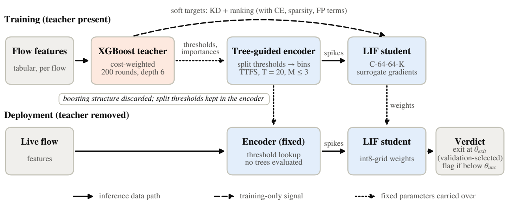
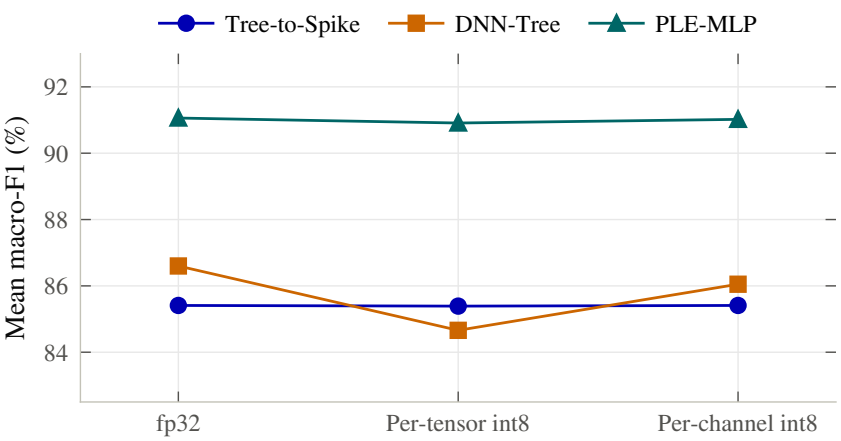
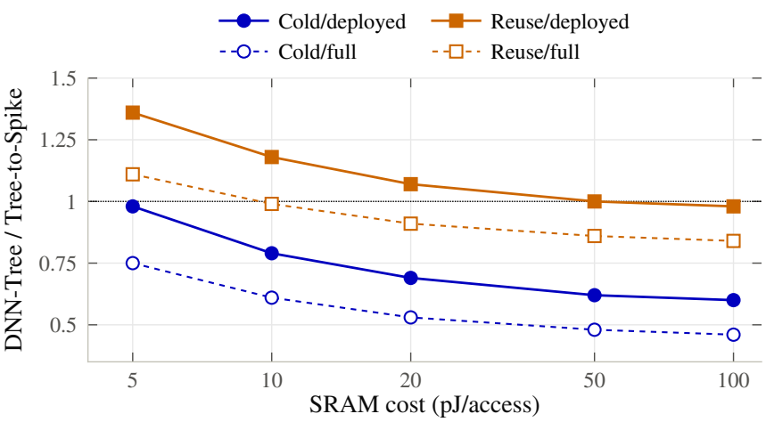

# Tree-to-Spike

**Tree-guided spike encoding for compact, energy-aware network intrusion detection on IoT traffic.**

[](LICENSE)


This repository holds the code, configurations, run records and analysis behind the
Tree-to-Spike journal manuscript (IEEE Transactions on Neural Networks and Learning Systems,
revision 1). Every number the manuscript reports is regenerated from the committed run records
by [`scripts/make_numbers.py`](scripts/make_numbers.py), and each one is listed with its source
file in [`results/tables/numbers_provenance.json`](results/tables/numbers_provenance.json).
The state that produced the manuscript's numbers is the annotated tag `tnnls-journal-r1`.

<p align="center">
  
</p>

## Contents

- [What Tree-to-Spike is](#what-tree-to-spike-is)
- [Main results](#main-results)
- [Repository layout](#repository-layout)
- [Installation](#installation)
- [Data](#data)
- [Quick start](#quick-start)
- [Reproducing the paper](#reproducing-the-paper)
- [Reproducibility notes](#reproducibility-notes)
- [Pre-registered analyses](#pre-registered-analyses)
- [Citation](#citation) and [license](#license)

## What Tree-to-Spike is

Tree-to-Spike turns a gradient-boosted tree ensemble into the input layer of a spiking network.

1. **Teacher.** A cost-sensitive XGBoost model is fitted on the training split only.
2. **Encoder.** Its split thresholds become per-feature latency bins, and its feature
   importances set each feature's channel budget; weak features are pruned. The encoder is
   fixed after fitting and emits time-to-first-spike codes over a window of T = 20 steps.
3. **Student.** A compact leaky integrate-and-fire MLP is trained on those spikes with
   cross-entropy, distillation from the teacher, a ranking term, spike sparsity and a
   false-positive penalty.
4. **Deployment.** Only the encoder and the int8-quantized student run. No tree is evaluated
   at inference. A confidence-triggered early exit is admitted per run when validation shows
   it costs at most one point of macro-F1.

The study compares Tree-to-Spike with three models trained on identical features, splits and
seeds:

| Model | What it is | Code |
|---|---|---|
| **Tree-to-Spike** | the method above | [`src/models/tree_to_spike.py`](src/models/tree_to_spike.py), [`src/training_treespike.py`](src/training_treespike.py) |
| **DNN-Tree** | the dense twin: same encoder input, same layer sizes and parameter count, ReLU instead of spikes, one step | [`src/models/dnn_student.py`](src/models/dnn_student.py), [`src/training_dnn.py`](src/training_dnn.py) |
| **Vanilla SNN** | LeakyParallel neurons on raw-feature latency codes (the best operating point of an earlier neuron-by-encoding sweep) | [`src/models/snn.py`](src/models/snn.py), [`src/training.py`](src/training.py) |
| **TASNN** | a reimplementation of the transformer-spiking IDS of Karthik et al. (*Scientific Reports*, 2026), run on the shared features | [`src/models/tasnn.py`](src/models/tasnn.py), [`experiments/TASNN/README.md`](experiments/TASNN/README.md) |

Reference points reported alongside: the GBDT teacher itself (full and validation-selected
compact), a dense twin on spike-time input (DNN-TQ, pre-registered experiment E1), and a
target-aware piecewise-linear-encoding MLP (PLE-MLP, item B3) as a strong
conventional-hardware baseline.

## Main results

Test macro-F1 (%) on the four IoT benchmarks, deployed configuration (int8 students), mean over
seeds 42 to 46. CICIoT2023 uses the 20-epoch, validation-selected runs of amendment A1.

| Dataset | Tree-to-Spike | DNN-Tree | Vanilla SNN | TASNN |
|---|--:|--:|--:|--:|
| CICIoT2023 | **75.20** | 74.75 | 62.72 | 60.00 |
| CICIoMT2024 | **89.42** | 89.24 | 72.61 | 74.18 |
| Edge-IIoTset | **83.94** | 80.60 | 75.39 | 78.37 |
| TON-IoT | 92.98 | **94.06** | 92.04 | 90.37 |
| **IoT mean** | **85.39** | 84.66 | 75.69 | 75.73 |

What the evidence supports:

- **Parity with the dense twin, robust to int8.** Tree-to-Spike leads DNN-Tree by 0.72 points
  at per-tensor int8, the deployed precision. In floating point the dense twin leads by 1.19,
  and with per-channel int8 by 0.65. The difference is quantization: Tree-to-Spike's int8
  change is within ±0.33 on every dataset, while DNN-Tree loses 6.53 points to per-tensor int8
  on Edge-IIoTset.
- **Clearly ahead of spiking baselines.** +9.70 over the Vanilla SNN and +9.66 over TASNN, on
  all four datasets (Friedman exact p = 0.0062).
- **The encoder is the mechanism.** In a step-by-step decomposition from the Vanilla SNN, the
  tree-guided encoder accounts for +9.26 of the gain; replacing tree thresholds with quantile
  bins loses 1.7 to 12.5 points while using 20 to 37% more operations.
- **Small and cheap in arithmetic.** A 21.4 KB deployed artifact (all four datasets within
  128 KB; the full GBDT teacher needs 748 KB) and 3.16× less arithmetic energy than DNN-Tree at
  32-bit (4.75× at int8). Including memory traffic, which is 92.3 to 99.7% of total energy,
  the two are near parity: for the deployed configuration the DNN-Tree / Tree-to-Spike ratio
  is 0.60 to 1.36 across the memory models and SRAM prices studied.
- **A strong conventional alternative exists.** PLE-MLP reaches 91.06 on the IoT four at fp32,
  with 18 to 32 times DNN-Tree's MACs. The contribution is the representation for a spiking
  substrate, not the highest accuracy on conventional hardware.

<p align="center">
  
  
</p>

All tables, per seed and per dataset, are in [`results/`](results) (map:
[`docs/RESULTS.md`](docs/RESULTS.md)); the general-purpose benchmarks (seven more datasets) are
reported there as well.

## Repository layout

```
src/            library: data loaders, models, training loops, metrics, operation counting
  data/         one loader per dataset, the leakage repairs, and the leakage-audit protocols
  models/       Tree-to-Spike encoder and student, DNN-Tree, Vanilla SNN, TASNN
experiments/    run.py + config.yaml per model and dataset (Tree-to-Spike, DNN-Tree, TASNN;
                the Vanilla SNN sweep under experiments/<dataset>/)
configs/        neuron-by-encoding configs of the Vanilla SNN sweep
scripts/        training orchestration, evaluation, analyses, tables, figures, numbers
                (index: scripts/README.md)
results/        committed run records and derived tables (map: docs/RESULTS.md)
  archive/      audit trail: pre-repair runs, leakage audit, superseded originals, run logs
Figures/        manuscript figures and the values they plot
docs/           datasets, reproduction guide, results map
tests/          unit tests
```

## Installation

Tested with Python 3.12.3, PyTorch 2.12.0 (CUDA 13.0) and XGBoost 3.2.0 on an NVIDIA H200.

```bash
git clone https://github.com/Trust-AI-ua/HiFi-SNN.git
cd HiFi-SNN
python3.12 -m venv .venv && source .venv/bin/activate
# PyTorch first, for your CUDA or CPU (see pytorch.org):
pip install torch==2.12.0 --index-url https://download.pytorch.org/whl/cu130
pip install -r requirements.txt
# B3 only (PLE-MLP); --no-deps keeps the installed PyTorch:
pip install --no-deps rtdl_num_embeddings==0.0.12
python -m unittest discover tests
```

## Data

The eleven datasets are public but not redistributed here. Download them into `dataset/`
(gitignored) with the folder names in [`docs/DATASETS.md`](docs/DATASETS.md), which also gives
the class taxonomy, split, preprocessing and source of each. Loaders build a cache on first
use.

| Primary (IoT) | Classes | Test flows |
|---|--:|--:|
| CICIoT2023 | 8 | 466,866 |
| CICIoMT2024 | 6 | 403,545 |
| Edge-IIoTset | 14 | 381,863 |
| TON-IoT | 10 | 42,209 |

The appendix adds seven general-purpose benchmarks: CSE-CIC-IDS2018, CIC-IDS2017, CTU-13,
KDDCup99, NSL-KDD, UNSW-NB15 and ISCX-IDS2012.

Two corpora are repaired before use ([`src/data/repair.py`](src/data/repair.py)). The
published Edge-IIoTset CSV reveals the class in two ways: the zero placeholder is spelled `0`
or `0.0` depending on the source capture, and rows whose fields contained commas sit one or two
columns off. The loader canonicalises the values, realigns the shifted rows and drops the one
class it cannot repair (MITM, so 14 classes instead of 15).
In CSE-CIC-IDS2018, four identifier columns exist only in one day's file and are zero-padded
for the other nine, which turns `Src Port` into a capture-day indicator; they are dropped.
The audit that found both is in
[`results/diagnostics/leakage_audit`](results/diagnostics/leakage_audit), and the runs from
before the repair are kept in [`results/archive`](results/archive).

## Quick start

Train and evaluate one model on one dataset and seed (writes
`results/<Model>/<dataset>/seed_<S>/results.json`):

```bash
python scripts/run_treespike.py toniot --seeds 42      # Tree-to-Spike
python scripts/run_dnn.py       toniot --seeds 42      # DNN-Tree
python scripts/run_tasnn.py     toniot --seeds 42      # TASNN
python scripts/run_sweep.py     toniot --only LeakyParallel --encodings latency --seeds 42   # Vanilla SNN
```

Each record holds the configuration, the split signature, training curves, test metrics
(macro-F1, MCC, balanced accuracy, detection and false-alarm rates, per class), spike and
operation counts, early-exit statistics and the teacher's own test score.

Regenerate every reported number and figure from the committed records:

```bash
python scripts/make_numbers.py               # results/tables/numbers_provenance.json (+ local numbers.tex)
python scripts/make_manuscript_figures.py    # Figures/, with consistency guards
```

## Reproducing the paper

[`docs/REPRODUCING.md`](docs/REPRODUCING.md) maps each table, figure and pre-registered item
to the commands that produce it, in order: main runs, ablations, precision reruns, early
exit, deployment measurement, the Part B items, derived tables, numbers and figures.
[`scripts/README.md`](scripts/README.md) indexes the scripts by purpose.

## Reproducibility notes

- **Seeds.** Every cell is five seeds, 42 to 46; SDs are sample SDs.
- **Thread count changes the teacher.** XGBoost's result depends on its OpenMP thread count.
  Leave `OMP_NUM_THREADS` and related variables unset (the production teacher uses 4 threads
  inside XGBoost); every run records the teacher's test score so a changed teacher is visible.
- **Determinism.** Training is deterministic on the tested stack; a 20-epoch run that selects
  epoch 10 reproduces the 10-epoch run exactly. TASNN's GPU evaluation is not bitwise
  reproducible (differences of about 0.02 macro-F1).
- **Guards.** New measurement paths were run only after reproducing stored values on unchanged
  cells; the figure script refuses to draw unless its inputs equal the committed ones.
- **Not in the repository.** Datasets, model checkpoints (`*.pt`) and per-timestep early-exit
  logits (about 13 GB) are regenerated by the scripts.

## Pre-registered analyses

The journal revision's additional analyses were registered before they ran:
[`results/preregistration/`](results/preregistration) (E1/E2 on 2026-09-24; Part B on
2026-09-28 with amendment 1). Their outputs are in [`results/journal_partB`](results/journal_partB),
`results/DNN-TQ` and `results/encoder_ablation`.

## Citation

If you use this code, please cite the accompanying manuscript; citation details are in
[`CITATION.cff`](CITATION.cff) and will be updated on publication.

## License

[MIT](LICENSE) © 2026. The datasets keep their own
licenses; see their sources in [`docs/DATASETS.md`](docs/DATASETS.md).
