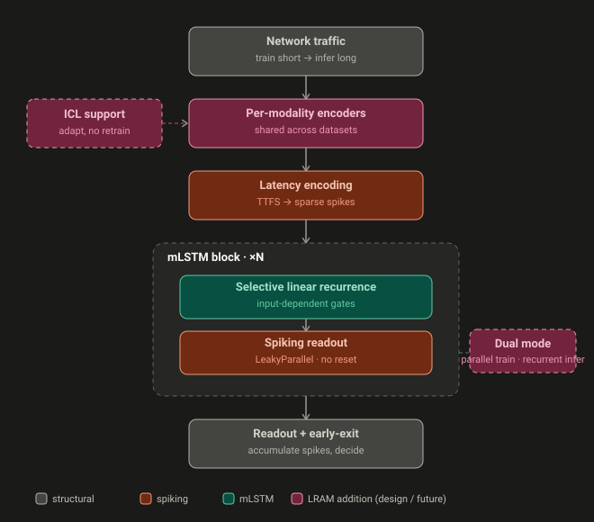

# S-xLSTM — Spiking xLSTM hybrid for NIDS

This directory houses the **Phase-2 hybrid** model built on top of the Phase-1
SNN ablation. It pairs the ablation's two winning ingredients — **latency
(TTFS) spike encoding** and the **`LeakyParallel`** spiking neuron — with an
xLSTM **mLSTM** selective linear recurrence. Only these two snntorch components
are used; no other neuron model or encoding is instantiated.

## Architecture



The implemented path (grey/coral/teal) is: latency (TTFS) spike encoding → `N` stacked mLSTM blocks, each a **selective linear recurrence** (input-dependent gates, kept linear so it stays parallelisable) followed by a reset-free **`LeakyParallel`** spiking readout → readout + early exit. **The pink blocks (ICL support, per-modality encoders, dual parallel-train / recurrent-infer mode) are LRAM design extensions and are *not* in the current implementation** — see the caveat at the bottom of this file.

## Pipeline

```
feature vector x in [0,1]^d   (per-modality preprocessing handled in src/data)
  -> latency (TTFS) encoding                      spikegen.latency  -> [T, B, F]
  -> S-xLSTM backbone x N:
         mLSTM selective linear recurrence        (input-dependent gates)
         -> LeakyParallel spiking readout          (reset-free parallel LIF)
  -> readout + early-exit                          (accumulate spikes, decide)
  -> attack class / alert
```

The spike layer sits **after** the linear recurrence: the recurrence stays
linear (keeping selectivity and parallelisability) and `LeakyParallel` is
reset-free, so the inter-block signal is sparse and addition-friendly. Because
`spikegen.latency` is non-differentiable, the first learnable projection lives
in the first mLSTM block, immediately after encoding.

## Layout

```
experiments/S-xLSTM/
├── kddcup99/    config.yaml + run.py   (the worked example from the reference)
├── nslkdd/      config.yaml + run.py
├── cicids2017/  config.yaml + run.py   (subsample_fraction honoured)
└── ctu13/       config.yaml + run.py   (subsample_fraction honoured)
```

Shared code lives in `src/`:
- `src/models/s_xlstm.py` — `mLSTMCell`, `SxLSTMBlock`, `SxLSTM` (+ early-exit).
- `src/training_sxlstm.py` — shared training/eval loop (multi-seed, rich metrics,
  early-exit stats), reusing `src/data` loaders and `src/metrics`.

Each `run.py` is a thin wrapper that reads its **sibling** `config.yaml` and
calls `src.training_sxlstm.run_experiment`.

## Running

The orchestrator and tmux wrapper take the **dataset as a positional argument**,
exactly like the SNN scripts (`run_sweep.py <dataset>` / `run_sweep_tmux.sh
<dataset>`). One invocation targets one dataset, so datasets can run in parallel
in separate tmux sessions.

```bash
# one dataset, default seed (42)
python experiments/S-xLSTM/kddcup99/run.py

# one dataset, multiple seeds
python scripts/run_sxlstm.py kddcup99 --seeds 42 43 44 45 46

# detached, survives disconnect (session hisnn-sxlstm-<dataset>)
./scripts/run_sxlstm_tmux.sh kddcup99 --seeds 42 43 44 45 46
./scripts/run_sxlstm_tmux.sh cicids2017 --seeds 44 45 46     # in parallel

# dry-run / force
python scripts/run_sxlstm.py nslkdd --dry-run
python scripts/run_sxlstm.py ctu13 --seeds 42 --force
```

## Results (stored separately from the SNN sweep)

```
results/S-xLSTM/<dataset>/seed_<N>/results.json   # full record (same schema as SNN + early-exit block)
results/S-xLSTM/<dataset>/seed_<N>/checkpoint.pt
results/summary_sxlstm.csv                        # one row per (dataset, seed); has a `model` column
```

Multi-seed isolation, skip-guard (existing `results.json` is not overwritten
unless `--force`), and `summary_sxlstm.csv` dedup on `(model, dataset, seed)`
all behave exactly like the SNN scripts. The `results.json` carries the same
metric schema as the SNN runs (accuracy, balanced accuracy, F1 macro/weighted,
per-class P/R/F1, MCC, Cohen's κ, ROC-AUC, DR/FAR, spike energy + sparsity,
parameter count, timing) **plus** an `early_exit` block (accuracy, macro-F1,
mean exit step) so the hybrid is directly comparable to the Phase-1 ablation.

## Key configuration choices

| Setting | Default | Rationale |
|---|---|---|
| `num_steps` (T) | 25 | matches the SNN ablation's latency window for direct comparison |
| `d_model` / `num_blocks` | 64 / 2 | from the reference prototype |
| `beta` | 0.9 | LeakyParallel initial membrane decay (learned) |
| `batch_size` / `epochs` / `lr` | 128 / 10 / 1e-3 | match the SNN ablation |
| `weight_decay` | 1e-4 | mild regularisation for the larger matrix-memory model |
| `class_weighted` | **false** | off by default so the hybrid is comparable to the unweighted SNN ablation; set `true` to use inverse-frequency CE weights |
| `early_exit_conf` | 0.9 | softmax-confidence threshold to stop reading time steps early |

## Notes and honest caveats

- The mLSTM runs as a **sequential** recurrence over the (short) latency window
  for clarity; a chunked parallel scan is a drop-in speed optimisation.
- The model is heavier than the plain SNN (matrix memory `C` is `[B, d, d]` per
  step), so per-run time is higher; `cicids2017`/`ctu13` honour
  `subsample_fraction` for time-budget control.
- Adding `iscxids2012` or `cse-cic-ids2018` is a one-line copy of any dataset
  directory (the loaders already exist and `run.py` is dataset-agnostic).
- The LRAM / in-context-support and dual parallel-train/recurrent-infer modes
  shown in the design figure are **not** implemented here; they are future
  extensions. This directory implements the core S-xLSTM backbone.
